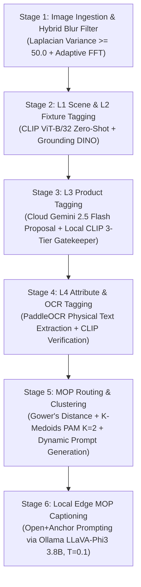

# 📖 석사 학위논문 상세 해설 (Dissertation Overview)

> **논문 제목 (Title)**: *Bottom-Up Multimodal Architecture for Hallucination-Suppressed Retail Vision-Language Captioning*  
> *(환각 억제형 소매 비전-언어 캡셔닝을 위한 상향식 멀티모달 아키텍처)*  
> **저자 (Author)**: 박준용 (Junyong Park)  
> **지도교수 (Supervisor)**: Dr Rita Borgo  
> **소속 (Institution)**: King's College London, Department of Informatics (MSc Data Science, 2025/26)  
> **발표 자료**: [`presentation.pdf`](./presentation.pdf) | [`presentation.html`](./presentation.html)

---

## 📌 1. 연구 요약 (Executive Summary)

소매 유통 산업에서 매대 모니터링(Shelf Monitoring)과 결품(Out-of-Stock, OOS) 탐지는 매출 손실을 막기 위한 핵심 과제입니다. 최근 거대 시각-언어 모델(Vision-Language Model, VLM)이 별도의 재학습 없이도 신제품을 인식할 수 있는 제로샷(Zero-shot) 대안으로 주목받고 있으나, 실제 매장에 배포할 때 **생성적 객체 환각(Generative Object Hallucination)**—특히 빈 매대나 가려진 구역에 상품이 존재한다고 허위로 묘사하는 **유령 재고(Phantom Inventory)** 현상—이라는 치명적인 장벽에 직면합니다.

또한 매장 내 실시간 처리, 클라우드 API 비용, 그리고 GDPR 개인정보 보호 제약으로 인해 실무 환경에서는 `LLaVA-Phi3 (3.8B)`와 같은 **소형 엣지 네이티브(Edge-Native) VLM**을 사용해야 하지만, 소형 모델일수록 시각적 정보가 모호할 때 언어 사전 확률(Language Prior)에 의존하여 환각을 일으키는 경향이 더욱 심화됩니다.

본 논문은 모델 파라미터에 대한 미세조정(Fine-tuning) 없이 오직 **검증된 물리적 시각 증거(Physical Visual Evidence)**로부터 의미를 상향식(Bottom-Up)으로 구축하는 **6단계 하이브리드 멀티모달 파이프라인(MOP: Metadata-Grounded Object-Prompting)**을 제안합니다. 실제 오프라인 소매 매장 이미지 **10,686장**을 대상으로 대규모 실증 평가를 수행한 결과:
- 객체 단위 환각 지표인 **`L-CHAIR_i`를 70.47%에서 40.36%로 30.11%p 절감**(상대적 감소율 **42.7%**)시켰으며,
- **LLM-as-a-Judge (Gemini 3.5 Flash)** 대규모 블라인드 쌍대 비교(N=10,686)에서 **71.1% 대 23.2%(약 3:1 승률)**로 베이스라인을 압도하였고,
- **Human-in-the-Loop (2인 블라인드 교차 평가, N=100)**에서도 **50.0% 대 37.0%**의 우위를 기록하며 엣지 VLM의 신뢰성을 획기적으로 개선할 수 있음을 입증하였습니다.

---

## 🎯 2. 연구 배경 및 핵심 연구 질문 (Chapter 1: Introduction)

### 2.1 문제 정의: 왜 기존 방식은 실패하는가?
1. **폐쇄형 지도학습(Closed-Set Supervised CV)의 확장성 한계**:
   - YOLO, Mask R-CNN 등 기존 객체 탐지 모델은 매일 신제품(SKU)이 출시되고 패키지 디자인이 바뀌는 동적 소매 환경에서 막대한 라벨링 및 재학습(Retraining) 비용을 발생시킵니다.
2. **소형 엣지 VLM의 유령 재고(Phantom Inventory) 환각**:
   - 매대 내 상품 밀집과 가려짐(Occlusion), 조명 반사 등으로 시각 신호가 약해지면, VLM 디코더는 시각 인코더의 증거 대신 사전 학습된 언어 분포(Textual Prior)에 의존하여 존재하지 않는 브랜드나 맛(예: 샌드위치 진열대에서 보이지 않는 *"Tuna, Chicken, Egg Mayo"*를 임의 생성)을 그럴듯하게 지어냅니다.
   - 유령 재고는 자동 발주 시스템(Automated Replenishment)의 재주문 트리거를 마비시켜, 스스로 교정되지 않고 누적되는 **구조적 지속 손실(Structurally Persistent Loss)**을 유발합니다.
3. **하향식(Top-Down) 카테고리 주입의 역설 (Language Prior Bias)**:
   - 초기 파일럿 실험에서 VLM의 출력을 제한하기 위해 표준 상품 분류 체계(GS1 Taxonomy 등)를 프롬프트에 먼저 주입하는 **하향식(Top-Down)** 방식을 시도했으나, 오히려 프롬프트에 포함된 카테고리 단어들이 디코더 어텐션을 잠식하여 존재하지 않는 상품을 강제로 매칭·환각하게 만드는 **언어 사전 편향(Language Prior Bias)**의 촉매로 작용함을 규명했습니다.

### 2.2 연구 질문 (Research Questions)
- **RQ1 (원인 규명)**: 하향식(Top-Down) 비즈니스 카테고리 강제 주입이 소형 엣지 네이티브 VLM에서 언어 사전 편향(Language Prior Bias)과 객체 환각을 유발하는 구체적 메커니즘은 무엇인가?
- **RQ2 (아키텍처 검증)**: 물리적 OCR 텍스트 앵커링과 CLIP 기반 3단계 신뢰도 필터링이 결합된 상향식(Bottom-Up) 파이프라인은 생성적 환각을 얼마나 효과적으로 억제할 수 있는가?
- **RQ3 (시스템 트레이드오프)**: 비즈니스 크리티컬 소매 환경에서 로컬 엣지 디바이스(`LLaVA-Phi3`)와 클라우드 거대 모델(`Gemini API`)을 결합한 하이브리드 구조의 성능 및 자원 소모 트레이드오프는 어떻게 나타나는가?

---

## 📚 3. 이론적 프레임워크 및 선행 연구 (Chapter 2: Literature Review)

### 3.1 인식론적 상향식(Epistemological Bottom-Up) 패러다임
본 연구의 **"상향식(Bottom-Up)"** 개념은 Anderson et al. (2018)의 시각적 영역 제안(Faster R-CNN 기반 Bottom-Up Attention)과 철학적으로 구별됩니다.
- **Anderson et al. (2018)**: 모델 내부 표현에서 *어떤 시각 영역에 주의를 기울일지(Feature Selection)*를 제안하는 기법.
- **본 연구의 Bottom-Up 아키텍처**: VLM이 의미론적 해석이나 캡션 생성을 시작하기 전에, 독립된 검증 모듈(PaddleOCR, CLIP Gatekeeper)을 통해 **인식론적으로 허용 가능한(Epistemically Admissible) 물리적 사실만을 먼저 확립**하고, 비즈니스 분류 체계(Taxonomy)는 시각 검증이 끝난 후에만 결합하는 **인지적 격리(Cognitive Isolation)** 원칙을 의미합니다.

### 3.2 환각의 이중 영역과 3중 방어 안전망 (Defence-in-Depth)
Ji et al. (2023)의 환각 분류 체계와 Ben-Levi et al. (2026)의 Mirage Probes 연구(텍스트 편향 영역 vs 허위 시각 표상 영역)에 대응하여, 본 아키텍처는 단일 기법이 아닌 **3중 방어선(Three-Tier Safety Net)**을 구축합니다:

| 방어 계층 | 핵심 기술 | 타깃 환각 유형 | 작동 원리 |
| :--- | :--- | :--- | :--- |
| **1차 방어선** | **PaddleOCR 물리적 앵커** | 외재적 환각 (Extrinsic) & 텍스트 편향 | 픽셀에 실제로 인쇄된 텍스트(브랜드명, 가격, 용량)만 기계적으로 추출하여 허구 브랜드 생성을 원천 차단 |
| **2차 방어선** | **Zero-Shot CLIP Gatekeeper** | 충실성 환각 (Faithfulness) & 허위 시각 표상 | 후보 태그와 이미지 간 코사인 유사도를 계산하여 3단계(`Hard` / `Soft` / `Absence`)로 게이팅 및 필터링 |
| **3차 방어선** | **Temperature 제한 ($T=0.1$)** | 내재적 환각 (Intrinsic) & 확률적 퇴화 | 디코더 소프트맥스 온도를 `0.1`로 극단적 억제하여 토큰 샘플링 단계의 창의적 외삽(Extrapolation) 차단 |

### 3.3 명시적 부재 인코딩 (Explicit Absence Encoding)
Ye et al. (2024)이 지적한 VLM의 **시각적 부재 인식 결핍(Visual Absence-Awareness Deficit)**을 해결하기 위해, 단순히 *"없는 것을 추측하지 마라"*는 부정 지시문(Negative Prompting)에 의존하는 대신, CLIP 검증에서 기각된(`Absence`, 유사도 $< 0.05$) 슬롯을 구조적으로 **`[Ambiguous]`** 마커로 치환하여 입력하는 **명시적 부재 인코딩**을 도입했습니다.

---

## ⚙️ 4. 제안 방법론: 6-Stage 하이브리드 파이프라인 (Chapter 3: Methodology)

시각적 사실 추출(Stages 1–4)과 비즈니스 문맥 라우팅 및 캡셔닝(Stages 5–6)을 철저히 분리한 6단계 파이프라인으로 동작합니다.

### 단계별 핵심 설계
1. **Stage 1 — 이미지 수집 및 하이브리드 모션 블러 필터링 (`pipeline_1_ingestion.py`)**:
   - 매장 내 이동 촬영 시 발생하는 모션 블러가 후속 OCR 및 객체 인식을 오염시키는 것을 막기 위해 **라플라시안 분산(Variance of Laplacian $\ge 50.0$)** 고속 1차 필터와 주파수 도메인 기반 **적응형 고속 푸리에 변환(Adaptive FFT)** 2차 필터를 결합하여 저품질 이미지를 선제적으로 걸러냅니다.
2. **Stage 2 — 거시적 씬(L1) 및 진열 집기(L2) 태깅 (`pipeline_3_dynamic_tagging.py`)**:
   - **L1 (Scene)**: CLIP 제로샷 분류를 통해 4대 소매 매대 유형(*Standard Aisle Shelf*, *Promotional Endcap*, *Checkout Area*, *Standalone Display Bin*)을 분류합니다.
   - **L2 (Fixture)**: 오픈셋 객체 탐지 모델인 **Grounding DINO**를 활용하여 선반(`shelf`), 진열 상자(`display box`), 빈 공간(`gap`) 등의 기하학적 바운딩 박스를 재학습 없이 추출합니다.
3. **Stage 3 — L3 상품 태깅 및 3-Tier CLIP Gatekeeper (`pipeline_3b_l3_product_tagging.py`)**:
   - 클라우드 VLM(Gemini 2.5 Flash)이 1차 후보 상품 키워드를 제안하면, 로컬 **CLIP Gatekeeper**가 이미지와의 코사인 유사도($S$)를 검증하여 3단계로 분류합니다:
     - **Hard Anchor ($S \ge 0.15$)**: 시각적 확신이 검증된 객체 → 최종 캡션에 **반드시 포함(MUST MENTION)**
     - **Soft Anchor ($0.05 \le S < 0.15$)**: 정황상 보조 단서 → 조건부 맥락 참고
     - **Absence ($S < 0.05$)**: 시각적 증거 부재 → 프롬프트에서 제거 및 **`[Ambiguous]`** 마커로 치환하여 억측 차단
4. **Stage 4 — L4 운영 속성 및 PaddleOCR 물리적 텍스트 앵커링 (`pipeline_3c_l4_attribute_tagging.py`)**:
   - **PaddleOCR**을 통해 상품 표면의 브랜드명, 가격표, 프로모션 문구를 물리적으로 추출하고, CLIP 의미 유사도 필터링을 거쳐 오탈자 노이즈를 제거한 뒤 위조 불가능한 **물리적 텍스트 앵커(Physical Text Anchor)**로 확정합니다.
5. **Stage 5 — Gower's Distance & K-Medoids 기반 MOP 동적 프롬프트 라우팅 (`pipeline_4_routing_clustering.py`)**:
   - Shazeer et al. (2017)의 희소 게이트 전문가 혼합(MoE) 개념을 프롬프트 레벨로 치환한 **MOP(Mixture of Prompts)** 라우팅 단계입니다.
   - L1~L4에서 추출된 혼합형 메타데이터(연속형 신뢰도 수치 + 범주형 씬/프로모션 변수 5종) 간의 거리를 왜곡 없이 계산하기 위해 유클리드 거리 대신 **가워 거리(Gower's Distance)**를 정의하고:
     $$D_{ij} = \frac{\sum_{k=1}^{p} w_{ijk} \cdot d_{ijk}}{\sum_{k=1}^{p} w_{ijk}}, \quad d_{ijk} = \frac{|x_{ik} - x_{jk}|}{R_k}$$
   - 이상치에 강건한 **K-Medoids (PAM)** 알고리즘으로 매대 아키타입을 군집화($K=2$)하여, 군집별 특성에 최적화된 **Open+Anchor 프롬프트 템플릿**을 동적으로 라우팅합니다.
6. **Stage 6 — 로컬 엣지 VLM 기반 Open+Anchor 캡셔닝 (`pipeline_5_mop_captioning.py`)**:
   - 매장 엣지 서버 환경(Ollama 구동 `llava-phi3`, 3.8B, $T=0.1$)에 동적 라우팅된 템플릿과 검증된 L1~L4 물리적 앵커를 주입하여 최종 캡션을 생성합니다.
   - **Open+Anchor 전략**: VLM의 전반적인 시각적 맥락(색상, 배치, 테마) 묘사 자유도는 열어두되(Open), 상품 식별은 검증된 Hard Anchor에 엄격히 구속(Anchor)하고 불확실한 영역은 `[Ambiguous]`로 침묵을 강제합니다.

---

## 📊 5. 실험 설계 및 대규모 실증 결과 (Chapter 4: Evaluation)

### 5.1 실험 환경 및 공정 비교 통제 (Fair Ablation Setup)
- **데이터셋**: 실제 리테일 매장 매대 이미지 **10,686장**
  - **Baseline (대조군)**: 파이프라인 제약 없이 순수 `llava-phi3 (3.8B)` 모델로 생성한 캡션 (10,686장 전수 완료)
  - **MOP (제안 모델)**: 6단계 상향식 파이프라인을 모두 거친 후 동일한 `llava-phi3 (3.8B)` 모델로 생성한 캡션 (API 한도 및 컨텍스트 초과 2장 제외한 **10,684장** 완료)
- **모델 용량 통제**: 초기 실험에서 발견된 모델 크기 교란 변수(`llava 7B` vs `llava-phi3 3.8B`)를 완전히 제거하고 두 시스템 모두 동일한 `llava-phi3 (3.8B)`를 사용하여 순수하게 **아키텍처의 효과**만 측정했습니다.

### 5.2 핵심 정량 평가 결과 요약

| 평가 차원 | 평가 지표 / 방법론 | 표본 규모 ($N$) | Baseline (Unconstrained) | Proposed (MOP Pipeline) | 핵심 성과 및 통계적 의미 |
| :--- | :--- | :---: | :---: | :---: | :--- |
| **객체 환각률 (RQ2)** | **L-CHAIR$_i$** (낮을수록 우수) | 10,686 / 10,684 | 70.47% | **40.36%** | **-30.11%p 절대 감소 (42.7% 상대 감소)** |
| **다차원 품질 평가** | **LLM-as-a-Judge** (Gemini 3.5 Flash) | 10,686 Pairs | 23.2% 승 (2,474장) | **71.1% 승 (7,597장)** | 무승부 5.8% (615장), **약 3:1 압도적 우위** |
| **인간 교차 검증** | **Human-in-the-Loop** (2인 블라인드) | 100 Pairs (200건) | 37.0% 승 | **50.0% 승** | 무승부 13.0% ($\kappa = 0.036$, 정보성 vs 안전성 분석) |
| **군집 라우팅 타당성** | **Dunn Index / Silhouette Score** | 1,000 Samples | — | **$K=2$ 최적** | Dunn **0.330**, Silhouette **0.556** (이중 모드 분포 증명) |
| **시스템 자원 효율성 (RQ3)** | **VRAM 점유율 / 장당 처리 시간** | 10,684 Images | ~5.5 GB VRAM | **~5.5 GB VRAM / 4.38s** | 보급형 엣지 GPU(RTX 3060 6GB) 실시간 구동 가능 |

### 5.3 세부 실험 분석
1. **객체 환각의 획기적 억제 (`L-CHAIR_i` 70.47% → 40.36%)**:
   - NLTK `WordNetLemmatizer`를 적용한 **L-CHAIR (Lemmatised CHAIR)** 평가 결과, 베이스라인은 언급된 객체의 70.47%가 시각적 근거 없는 환각이었으나, MOP 파이프라인은 이를 **40.36%**로 낮추어 **상대적으로 42.7%의 환각을 제거**했습니다.
2. **LLM-as-a-Judge vs Human-in-the-Loop 이중 검증 (Dual-Verification)**:
   - Kumar et al. (2026)의 *순위-점수 분리(Ranking-Scoring Decoupling)* 이론에 입각하여 절대 점수 대신 **블라인드 쌍대 비교(Pairwise Comparison)** 프로토콜을 채택했습니다.
   - Gemini 3.5 Flash 심사관(시각적 정확성, 사실 완결성, 불확실성 처리 3차원 루브릭)에서는 MOP가 **71.1% 승률**을 거두었으며, 인간 평가자 2인의 블라인드 평가에서도 MOP가 **50.0% 대 37.0%**으로 승리했습니다.
   - 인간 평가자 간 일치도($\kappa = 0.036$)가 낮게 나타난 원인을 심층 분석한 결과, 한 평가자는 베이스라인의 화려하고 긴 서술(유창성/정보량)을 선호한 반면 다른 평가자는 MOP의 엄격한 사실성(안전성)을 우선시하는 **정보성 대 안전성(Informativeness vs. Safety)의 본질적 트레이드오프**가 존재함을 규명했습니다.
3. **K-Medoids 최적 군집 수($K=2$)의 수학적 도출**:
   - $K=2$에서 Dunn Index **0.330**, Silhouette Score **0.556**으로 정점을 기록한 뒤 $K \ge 3$에서 급락하는 현상을 통해, 소매 매대 환경이 복잡한 다중 분포가 아니라 **정돈된 일반 매대(Standard Shelf)**와 **혼잡한 판촉 매대(Cluttered Promotional Display)**라는 **이중 모드(Bimodal Distribution)**로 양분됨을 수학적으로 입증했습니다.
4. **언어 사전 편향 메커니즘 규명 (RQ1)**:
   - 디코더 전용 VLM에서 프롬프트에 주입된 카테고리 토큰이 가려진(Occluded) 시각 토큰보다 높은 어텐션 가중치를 획득하여 텍스트 편향(Textual Bias)과 허위 시각 표상(Spurious Image Mirage)을 동시에 촉발함을 밝히고, 상향식 3중 안전망이 두 영역을 모두 차단함을 보였습니다.

---

## 🔍 6. 한계점 및 심층 논의 (Section 4.3: Discussion & Limitations)

본 논문은 제안 아키텍처의 한계와 상업적 트레이드오프를 투명하고 엄밀하게 고찰합니다:

1. **연쇄 오류 (Cascading OCR Error)**:
   - 상향식 구조에서 1차 OCR이 조명 반사나 구겨진 포장으로 인해 잘못된 문자열을 추출하면 후속 VLM이 이를 사실로 받아들이는 위험이 있습니다. 현재 아키텍처에서는 하류의 **CLIP Gatekeeper**가 OCR 텍스트까지 의미 유사도로 재검증하여 2차 방어선 역할을 수행하지만, 향후 OCR 자체의 문자 인식 신뢰도(Confidence Weighting)를 결합한 사전 필터링이 필요합니다.
2. **환각 억제와 태그 기아(Tag Starvation)의 비대칭적 경제성 정당화**:
   - 엄격한 CLIP 필터링으로 인해 심하게 가려진 실제 상품까지 일부 탈락하여 전체 탐지량이 약 **14.2% 감소**하는 **태그 기아(Tag Starvation)** 현상이 발생합니다.
   - 그러나 유통 경제학 문헌(DeHoratius & Raman, 2008; Farias et al., 2020; Bassamboo et al., 2020)에 따르면, **유령 재고(False Positive)**는 자동 발주를 막아 인간이 직접 개입할 때까지 결품이 영구 지속되는 **비자기교정(Non-self-correcting) 누적 손실**(연 매출의 약 4% 손실, 전체 결품 원인의 최대 65%)을 낳는 반면, **단순 탐지 누락(False Negative)**은 이미 매대에 상품이 진열되어 있어 판매가 가능하고 다음 스캔 주기에 자연 복구되는 **일시적(Transient) 오차**입니다. 즉 오탐 비용이 미탐 비용보다 3~5배 이상 크므로, 탐지량 14.2%를 희생해 환각을 42.7% 억제한 설계는 상업적으로 완전히 정당화됩니다.
3. **CLIP의 구조적 한계 (Bag-of-Words Vulnerability)**:
   - OpenAI CLIP ViT-B/32는 어순과 미세한 구성적 차이를 구분하지 못하는 Bag-of-Words 한계(Yuksekgonul et al., 2022)를 지닙니다. 엣지 VRAM 제약(5.5GB)으로 인해 본 프로토타입에서는 경량 CLIP을 채택했으나, *"Coke Zero"*와 *"Diet Coke"* 같은 미세 변종을 완벽히 구분하기 위해 향후 **SigLIP**(Zhai et al., 2023)이나 **F-CLIPScore**(Oh & Hwang, 2025)로의 업그레이드를 제안합니다.
4. **부정 제약 결핍(Negative Constraint Deficit)과 프롬프트 누출(Prompt Leakage)**:
   - 3.8B 규모의 소형 엣지 VLM은 복잡한 메타데이터나 강한 부정 지시문을 처리할 때 지시문 자체를 캡션에 그대로 복창(Parroting)하는 프롬프트 누출 취약성을 보였습니다. 이를 근본적으로 방어하기 위해 정규식 및 경량 파서로 수치/기계적 메타데이터를 사전 살균하는 **입력 살균(Input Sanitisation)** 아키텍처를 설계 원칙으로 제시했습니다.

---

## ⚖️ 7. 법적·사회적·윤리적·직업적 쟁점 (Chapter 5: LSEPI)

- **직업 윤리 및 투명성 (BCS Code of Conduct)**: 시스템의 출력이 절대적 확신이 아닌 3단계 신뢰도(`Hard`/`Soft`/`Absence`)로 등급화된 결과임을 명시하여 의사결정자의 맹신을 방지합니다.
- **데이터 프라이버시 및 GDPR 준수**: 매장 고객의 얼굴 등 생체 개인식별정보(PII)가 비가역적으로 사전 블러(Pre-blurred) 처리된 안전한 데이터셋만을 사용했으며, 로컬 엣지 디바이스에서 즉각 특징 추출 및 마스킹을 수행하는 **엣지 인텔리전스(Edge Intelligence)** 구조로 GDPR의 데이터 최소화 원칙을 충족합니다.
- **환경적 지속 가능성 (Green AI)**: 막대한 GPU 클러스터 전력을 소모하는 파운데이션 모델 미세조정(Fine-tuning)을 전면 배제(**Training-Free**)하여 훈련 단계의 탄소 발자국을 원천 제거했습니다.
- **사회·경제적 영향 및 직무 재설계 (Human-AI Copilot)**: 매장 직원을 대체하거나 감시하는 도구가 아닌, 단순 반복적인 매대 순찰 업무를 자동화하여 직원이 대시보드 분석, 플래노그램 보정, 공급망 협상 등 고부가가치 의사결정 업무로 전환하도록 돕는 **코파일럿(Copilot)** 모델을 지향합니다.
- **알고리즘 공정성 및 브랜드 형평성 (Brand Equity)**: 인터넷 대규모 데이터로 사전 학습된 CLIP/VLM은 디지털 발자국이 적은 소규모·신생·소수자 브랜드 상품에 대해 상대적으로 낮은 유사도 점수를 부여하여 `Soft`/`Absence`로 누락시킬 위험("부익부 빈익빈" 효과)이 있음을 지적하고, 브랜드별 기각률 모니터링 대시보드와 정기 공정성 감사(Fairness Audit)를 해결책으로 제안했습니다.

---

## 🚀 8. 결론 및 향후 연구 방향 (Chapter 6: Conclusion & Future Work)

### 8.1 4대 핵심 학술적 기여
1. **하향식 카테고리 주입의 언어 사전 편향(Language Prior Bias) 실증 규명**: 비즈니스 지식의 주입 시점(시각 검증 전 vs 후)이 분류 보조제가 될지 환각 촉매가 될지를 결정함을 입증.
2. **초경량 3-Tier CLIP Gatekeeper 및 물리적 OCR 앵커 통합**: 10,686장의 실제 소매 이미지에서 객체 환각을 **30.11%p (상대 42.7%)** 억제.
3. **Gower's Distance & K-Medoids ($K=2$) 기반 동적 MOP 라우팅 확립**: 혼합형 리테일 메타데이터 공간에서 매대 구조의 이중 모드 분포를 수학적으로 증명하고 맞춤형 프롬프트 라우팅 구현.
4. **엣지-클라우드 하이브리드 협력 아키텍처 실증**: 5.5GB VRAM의 보급형 엣지 환경과 클라우드 API를 결합해 장당 평균 **4.38초**의 준실시간 추론 파이프라인 완성.

### 8.2 향후 연구 과제 (Future Work)
- **디코더 내부 표현 제어 기법 결합**: 본 연구의 입력단(Input-side) 통제에 더해, 추론 시점의 내부 표상을 직접 교정하는 **SRF (Spectral Representation Filtering, Ali et al., 2025)** 및 **VISTA (Li et al., 2025)** 등 디코더단(Decoder-side) Training-Free 기법을 결합한 다층 방어 체계 구축.
- **차세대 비전 인코더 및 로컬 모델 고도화**: Bag-of-Words 한계를 극복하기 위한 **SigLIP** 도입 및 `Llama-3 Vision` 등 차세대 로컬 모델을 통한 클라우드 의존성 제거.
- **적응형 임계값 및 다중 에이전트(Multi-Agent) 자동화**: 베이지안 최적화 기반의 조도·환경 적응형 임계값(Adaptive Threshold) 도입, 그리고 '비전 에이전트'와 '비즈니스 분석 에이전트'가 실시간 협업하는 자율형 멀티 에이전트 시스템으로의 확장.
